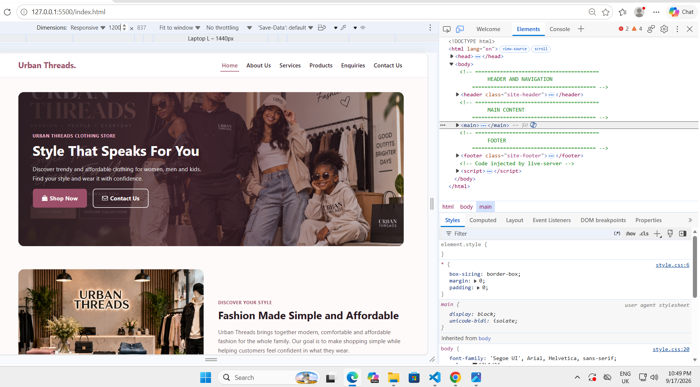
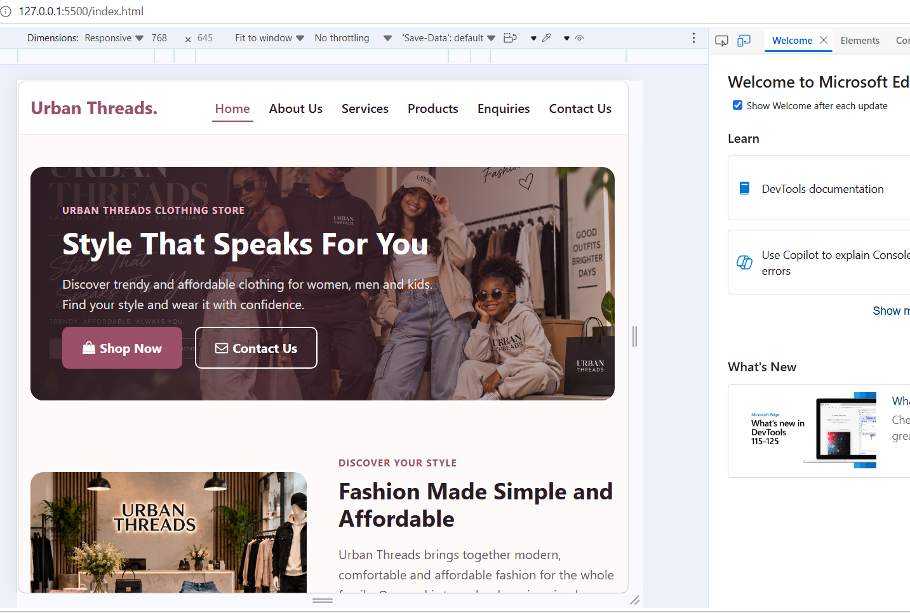
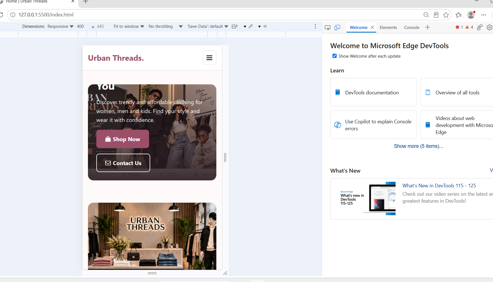

# M_K_Mokwena_ST10536622_Urban_Threads_WEDE5020_Poe

---

# Project Title: Urban Threads

## My Project – Urban Threads

Customers can peruse stylish and reasonably priced apparel for men, women, and children on the Urban Threads apparel Store website. The project's main goal is to employ HTML and CSS to create a straightforward, appealing, and easy-to-use shopping experience.

---

## Student Information

| Information | Details |
|---|---|
| Student Full Name | Mokwena Mohlallwe Kelly |
| Student Number | ST10536622 |
| Programme | Diploma in Information Technology in Software Development |
| Year | 1 |
| Group | 4 |
| Module | Web Development |
| Module Code | WEDE5020 |
| Lecturer | Deogratias Phiri |

---

## Project Overview

The South African apparel retailer Urban Threads is situated in Johannesburg, Gauteng. It was founded in 2022 with the goal of offering its clients fashionable and reasonably priced apparel. The business sells casual clothing, accessories, and shoes for men, women, and children.

The purpose of the Urban Threads website is to provide the company with an online presence where clients may peruse merchandise, discover more about the store, send inquiries, and readily obtain contact details.

---

## Website Goals and Objectives

### Specific Goals

- **Goal 1:** Improve Urban Threads' online presence.
- **Goal 2:** Provide customers with an online catalogue to browse available clothing.
- **Goal 3:** Make it easier for customers to contact the business and submit enquiries.

### Key Performance Indicators (KPIs)

- **KPI 1:** Increase website visits by 40% within the first three months after launch.
- **KPI 2:** Display all available clothing products on the website within the first month.
- **KPI 3:** Receive at least 50 customer enquiries per month through the website.
---

## Key Features and Functionality

### Homepage
- Hero banner
- Featured clothing categories
- Shop Now button
- Easy navigation

### About Us
- Company information
- Mission
- Vision
- Reasons to choose Urban Threads
  
### Enquiry
- Customer enquiry form
- Product enquiries
- Order enquiries
- Delivery enquiries
- Returns and exchanges
- General enquiries

### Contact
- Contact information
- Physical address
- Phone number
- Email address
- Business hours
- Contact form

### Products
- Product images
- Product names
- Product prices
- Product sizes
- Add to cart links
- Responsive product layout

### Additional Features
- Responsive design
- Mobile-friendly layout
- Easy navigation
- Responsive images
- Hover and focus effects
- Accessible forms
- Consistent colour scheme and styling

---

## Timeline and Milestone

| Milestones | Target Date | Status |
|---|---|---|
| Planning & Wireframing | 05/08/2026 | Complete |
| Part 1: Submit Proposal and Semantic HTML Structure | 14/08/2026 | Complete |
| Add external CSS styling and mobile responsiveness | 16/09/2026 | Complete |
| Part 2: Submit CSS and Responsive Website | 18/09/2026 | Complete |
| Adding JavaScript and Interactivity | TBC | Planned |
| Part 3: Final Testing and Submission | TBC | Planned |

---

## Part 1 Details

Part 1 concentrated on utilizing HTML to create the fundamental framework and content of the Urban Threads website.

### Pages Completed
- index.html
- about_us.html
- services.html
- products.html
- enquiries.html
- contact.html
  
### Structure and Semantics
- Semantic HTML5 elements like header, nav, section, form, and footer were used.
- Added links for navigating across the pages of the website.
- Headings, paragraphs, lists, pictures, and forms have all been included.

### Features Completed
- Developed the fundamental framework for the website.
- Information regarding Urban Threads has been added.
- Added apparel items with names, pricing, and pictures.
- An inquiry form has been added.
- A contact form and contact details have been added.
- Made the website's sitemap.
- Updated the README.md file with the project details.

---

### Sitemap

---

## Part 2 Details

In Part 2, we used CSS to enhance the Urban Threads website's visual appeal and responsiveness.

### CSS Styling
- The external style.css file was updated.
- Padding, margins, typefaces, and colors were added.
- The product sections, buttons, forms, and navigation were all styled.
- Hover, focus, and active effects were added.

### Layout
- Flexbox was used to arrange and align the components of the website.
- Products and other sections were arranged using CSS Grid.
- Better alignment and spacing throughout the website.

### Responsive Design
- Media queries for various screen sizes have been included.
- Designed mobile, tablet, and desktop responsive layouts.
- Relative units like %, rem, and em were used.
- Images are now responsive to various screen sizes.

### User Experience
- Improved navigation and readability.
- All pages have a clear and consistent style.
- Labels and focus styles are used to improve form accessibility.

### Testing
The website was tested using browser developer tools on different screen size.

### Desktop View

---

### Tablet View

---

### Mobile View

---

## Changelog

| Date | Version | Change Description |
|---|---|---|
| 10/08/2026 | v1.0 | Initial setup, added folder structure |
| 12/08/2026 | v1.1 | Added index.html and basic navigation |
| 14/08/2026 | v1.2 | Added about_us.html and enquiries.html |
| 25/08/2026 | v1.3 | Added initial style.css |
| 12/09/2026 | v2.0 | Corrected HTML errors from Part 1 |
| 12/09/2026 | v2.1 | Updated style.css with typography, colours and layout styling |
| 12/09/2026 | v2.2 | Added Flexbox and CSS Grid for website layouts |
| 12/09/2026 | v2.3 | Added responsive design using media queries for tablet and mobile devices |
| 12/09/2026 | v2.4 | Added hover, focus and active styles to navigation links, buttons and form elements |
| 12/09/2026 | v2.5 | Updated README.md with Part 2 information |
| 17/09/2026 | v2.6 | Updated Urban Threads colour scheme |
| 17/09/2026 | v2.7 | Added Urban Threads fashion images |
| 17/09/2026 | v2.8 | Updated Home, Services and Products pages |
| 17/09/2026 | v2.9 | Updated Enquiries and Contact Us pages |
| 17/09/2026 | v3.0 | Added comments to HTML and CSS code |
| 17/09/2026 | v3.1 | Tested website responsiveness on desktop, tablet and mobile screen sizes and added screenshot evidence to README.md |
| 17/09/2026 | v3.2 | Added responsive image techniques using picture, srcset and sizes attributes |
| 09/10/2026 | v3.3 | Improved default CSS styling based on Part 2 feedback by adding consistent text wrapping, form fonts and minimum input heights to improve readability and usability. |
| 09/10/2026 | v3.4 | Improved responsive layout by adjusting container widths, form elements and product information spacing for smaller mobile screens. |
| 09/10/2026 | v3.5 | Improved accessibility by adding visible keyboard focus outlines and support for reduced motion preferences. |
| 09/10/2026 | v3.6 | Standardised the CSS folder and stylesheet filename to match the links used in the HTML pages and improve compatibility with case-sensitive hosting platforms. |
| 09/10/2026 | v3.7 | Expanded the README changelog with more detailed descriptions of the changes made in response to Part 2 lecturer feedback. |

---

## References

GitHub. (2026). *GitHub Pages*. Available at: https://pages.github.com/ (Accessed: 6 September 2026).

Google Fonts. (2026). *Google Fonts*. Available at: https://fonts.google.com/ (Accessed: 6 September 2026).

MDN Web Docs. (2026). *CSS: Cascading Style Sheets*. Available at: https://developer.mozilla.org/en-US/docs/Web/CSS (Accessed: 6 September 2026).

MDN Web Docs. (2026). *CSS Flexible Box Layout*. Available at: https://developer.mozilla.org/en-US/docs/Web/CSS/CSS_flexible_box_layout (Accessed: 6 September 2026).

MDN Web Docs. (2026). *CSS Grid Layout*. Available at: https://developer.mozilla.org/en-US/docs/Web/CSS/CSS_grid_layout (Accessed: 6 September 2026).

MDN Web Docs. (2026). *Using Media Queries*. Available at: https://developer.mozilla.org/en-US/docs/Web/CSS/CSS_media_queries/Using_media_queries (Accessed: 6 September 2026).

W3Schools. (2026). *CSS Tutorial*. Available at: https://www.w3schools.com/css/ (Accessed: 6 September 2026).

W3Schools. (2026). *Responsive Web Design*. Available at: https://www.w3schools.com/css/css_rwd_intro.asp (Accessed: 6 September 2026).

ZADNA. (2026). *ZA Domain Name Authority*. Available at: https://www.zadna.org.za/ (Accessed: 6 September 2026).

---

